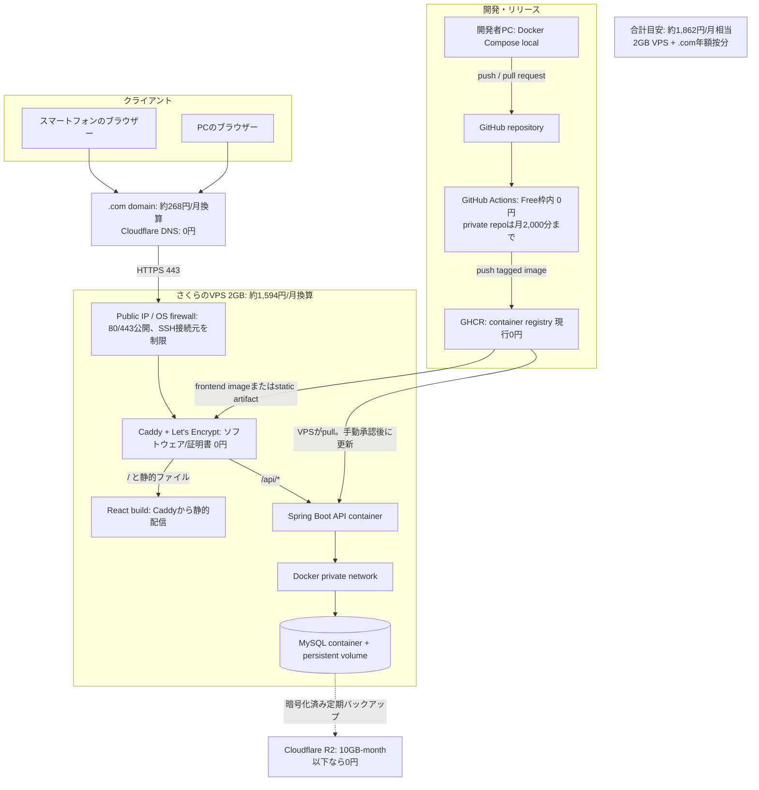
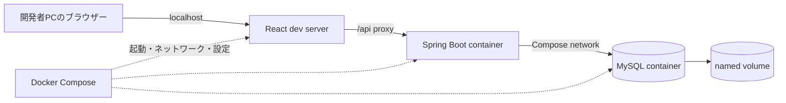
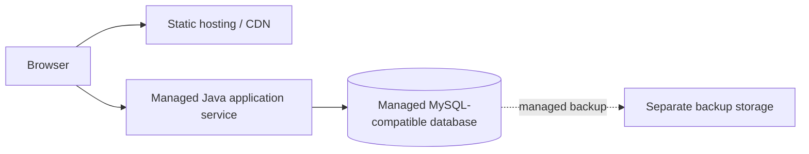

# アーキテクチャ設計書

## 1. 文書情報

| 項目 | 内容 |
| --- | --- |
| バージョン | 1.2 |
| 状態 | テスト環境案。公開候補と費用は将来検討用の参考情報 |
| 作成日 | 2026-09-26 |
| 関連文書 | [概要設計書](overview-design.md)、[インフラ・運用設計書](detailed-design/infrastructure-design.md) |
| 対象読者 | 全開発者、インフラ担当、運用担当 |

## 2. アーキテクチャの決定方針

今回の対象は本番公開ではなく、テスト環境の構築である。最安案は既存の開発PCでDocker Composeを使い、React、Spring Boot、MySQLの3サービスを起動する構成で、追加のクラウド利用料・独自ドメイン費用は0円を目標とする。同一LAN外から一時アクセスする必要がある場合だけ、Cloudflare Quick Tunnelを追加する。

以下のVPS・ドメイン等は将来公開時に再検討する参考案であり、今回契約・選定する対象ではない。テスト中は架空データを使い、DBポートをインターネットへ公開しない。

将来公開時に比較する候補は次のとおり。採用は確定しておらず、今回のテスト環境には適用しない。

| 役割 | 将来公開時の候補 | 採用理由・留意点 |
| --- | --- | --- |
| ソース管理 | GitHub | ソース、設計書、レビューを共有 |
| CI | GitHub Actions | PRでテストとイメージビルドを実施。無料枠は利用条件を確認 |
| コンテナ保管 | GitHub Container Registry (GHCR) | CIで作った本番イメージをVPSへ渡す |
| 公開サーバー | さくらのVPS 2GB（年額払い） | 月額換算を抑えつつ国内リージョンでCompose/MySQLを運用。メモリ監視と4GBへの増強判断が必要 |
| OS | Ubuntu Server LTS等 | サポート期間、Docker対応、セキュリティ更新を確認 |
| HTTPS/リバースプロキシ | Caddy | HTTPS終端、Let's Encrypt証明書管理、SPA配信とAPI振り分け |
| TLS証明書 | Let's Encrypt | Caddyによる自動取得・更新を想定 |
| アプリDB | MySQL | ローカル開発と公開のDB製品を統一 |
| バックアップ保存 | Cloudflare R2 | Standard 10GB-month等の無料枠内を想定。超過時の料金を監視 |
| ドメイン/DNS | `.com`ドメイン + Cloudflare DNS | ドメインの更新価格を確認。DNSはCloudflare Freeを想定 |

VPS、ドメイン、バックアップ保存には料金が発生する可能性がある。正確な月額料金、リージョン、メモリ、ディスク、バックアップ機能は契約時点で公式情報を確認する。無料枠を恒久的な前提にしない。

## 3. 参考：将来の公開環境アーキテクチャ

### 3.1 料金の目安（2026-10-13確認）

| サービス/項目 | 概算 | 見積もり条件 |
| --- | ---: | --- |
| さくらのVPS 2GB | 約1,594円/月 | 年額19,118円を12か月で按分。今回の低額公開案。低頻度利用を前提にメモリ制限・負荷試験・監視を行う。2GBプランはSLA対象外 |
| さくらのVPS 4GB（増強先） | 約3,227円/月 | 年額38,720円の按分。2GBでOOM、メモリ逼迫、応答遅延が発生した場合の移行先 |
| `.com`ドメイン | 3,220円/年（約268円/月） | さくらのドメイン掲載価格。更新時価格、キャンペーン、TLD変更は別途確認 |
| Cloudflare DNS | 0円 | Freeプランの範囲で利用する想定。ドメイン取得費用は別 |
| Caddy / Let's Encrypt | 0円 | ソフトウェアと証明書の利用料。VPS運用作業は別 |
| GitHub Actions | 0円の想定 | GitHub Freeのprivate repositoryは月2,000分まで。支出上限を設定して追加課金を防ぐ |
| GHCR | 現行0円の想定 | GitHubはContainer registryのイメージ保管・帯域を現在無料としている。ポリシー変更に備えて契約時に再確認 |
| Cloudflare R2バックアップ | 0円の想定 | Standard storage 10 GB-month、月100万Class A・1,000万Class B操作まで。超過分はStorageが$0.015/GB-month。Egressは無料 |
| **推奨案合計** | **約1,862円/月相当** | 2GB VPS + `.com`ドメインの年額按分。DNS、Caddy、証明書、規定内CI/バックアップ枠が無料の前提 |
| Oracle Cloud Always Free | サーバー費用0円の想定 | A1 Computeは月1,500 OCPU時間・9,000 GB時間（合計2 OCPU/12GB相当）、Block Volume 200GB等が無料。独自ドメインは別途（`.com`なら約268円/月相当）。容量確保、回収、仕様変更のリスクがあり安定稼働を保証しない |

2GB VPS案は、従来の4GB VPS案（約3,495円/月相当）より約1,633円/月、約47%低い。初回はVPS年額19,118円とドメイン年額3,220円の支払いが必要になる。概算には開発者の作業時間、バックアップ10GB超過、GitHub Actions無料枠超過、ドメイン価格改定は含めない。R2はバックアップ総量と操作数が無料枠内の場合に限り0円。契約時点の支払方法・最低利用期間・価格を申込画面で再確認する。

参照した公式価格情報:
- さくらのVPS料金: https://vps.sakura.ad.jp/specification/
- さくらのドメイン料金: https://domain.sakura.ad.jp/gtld/com/
- Cloudflare R2料金: https://developers.cloudflare.com/r2/pricing/
- Cloudflare Pagesの制限（静的配信を分離する場合）: https://developers.cloudflare.com/pages/platform/limits/
- Oracle Cloud Always Freeリソース・回収条件: https://docs.oracle.com/en-us/iaas/Content/FreeTier/freetier_topic-Always_Free_Resources.htm
- GitHub Actions料金: https://docs.github.com/en/billing/concepts/product-billing/github-actions
- GitHub Packages/GHCR料金: https://docs.github.com/en/billing/concepts/product-billing/github-packages

### 3.2 リクエスト経路

1. 利用者のブラウザーが独自ドメインへHTTPS接続する。
2. DNSがVPSのIPアドレスを返す。
3. VPSのファイアウォールが80/443を受け付ける。SSHは鍵認証とし、可能なら接続元を制限する。
4. CaddyがTLSを終端する。HTTPアクセスはHTTPSへ転送する。
5. CaddyはReactの静的ファイルを配信し、`/api/*`だけをSpring Bootコンテナへ転送する。
6. Spring BootはDockerのprivate network経由でMySQLへ接続する。
7. MySQLはnamed volumeへデータを永続化する。DBポートはホスト/インターネットへ公開しない。

### 3.3 デプロイ経路

1. 開発者がGitHubへPull Requestを作成する。
2. GitHub Actionsがフロントエンド/バックエンドのテストとコンテナビルドを行う。
3. mainへのマージ後、承認されたタグ付きイメージをGHCRへpushする。
4. 初期運用ではAdminがVPS上でComposeイメージを更新し、マイグレーション・healthcheck・疎通を確認する。
5. 自動デプロイを追加する場合、GitHub ActionsのEnvironment承認と、権限を限定したSSH鍵/トークンを使う。root鍵や本番DB資格情報をActionsへ渡さない。

CIとGHCRの無料利用枠・イメージ保管上限は変更されうるため、利用開始時に確認する。開発ブランチ用イメージと本番イメージはタグで区別し、`latest`だけに依存しない。

## 4. ローカル開発アーキテクチャ

ローカルと本番は同じDB製品（MySQL）を用いる。本番のCaddy/TLS経路はローカルでは省略または開発用proxyで代替できる。DBデータはnamed volumeに保持し、通常停止とボリューム削除を区別する。

## 5. サービス間の境界とポート

| コンポーネント | 公開範囲 | 接続先 |
| --- | --- | --- |
| Caddy | インターネットから80/443 | ブラウザー、frontend静的ファイル、Spring Boot |
| Spring Boot | Docker private networkのみ | Caddy、MySQL |
| MySQL | Docker private networkのみ | Spring Bootのみ |
| SSH | 管理用途。可能なら接続元IP制限 | Adminの管理端末 |
| GitHub Actions | GitHub管理のCI環境 | GHCR。デプロイ時のみ限定SSH接続 |
| Backup storage | アプリから暗号化データを書き込み | VPSとは独立したストレージ事業者 |

本番ではMySQLの3306番ポートをインターネットへ公開しない。APIコンテナも直接公開せず、Caddy経由だけにする。

## 6. データ、秘密情報、バックアップ

- MySQLデータはnamed volumeに保存する。volumeは障害・VPS停止に対するバックアップではない。
- DBパスワード、GitHub/GHCR資格情報、デプロイ鍵はGitへコミットせず、ホスト上の制限された環境ファイルまたはSecret Storeを使う。
- バックアップはMySQL dump等を暗号化し、VPSとは別事業者のストレージへ保存する。ストレージのライフサイクルとアクセス権を設定する。
- バックアップ頻度は初期案として日次、保持期間は直近30日を候補とし、費用・記録頻度・損失許容時間を見て確定する。
- バックアップから別環境への復元テストを公開前に行う。CSVエクスポートは初期リリースに含めないため、利用者向け代替手段として扱わない。
- 係数マスタの変更とアプリのバージョンを記録し、過去の消費カロリー推定値は記録時のスナップショットを維持する。

## 7. 低額2GB VPS案の評価

### 利点

- フロント、API、DBが同一のComposeネットワークにあり、構成と通信を理解しやすい。
- 3アカウント程度の低頻度利用なら、4GBプランより固定費を抑えて始められる。
- ローカル開発と本番でDocker Compose/MySQLの概念を共通化できる。
- DBを専用マネージドサービスに分離するより月額を抑えられる可能性がある。

### リスクと対策

- VPS障害がフロント/API/DBすべてに影響する。別事業者のバックアップと復元手順を持つ。
- 2GBではJVM、MySQL、OSのメモリが競合しやすい。コンテナのメモリ上限とJVM heapを設定し、負荷試験・OOM監視を行う。継続的な逼迫があれば4GBへ増強する。
- 2GBプランはSLA対象外。可用性要件が上がった場合は上位プランや別構成を検討する。
- OS・Docker・MySQLの更新を自分で管理する。更新前にバックアップと復元確認を行う。
- 単一ディスク障害・誤操作・ランサムウェアに備え、同一VPS内のコピーだけをバックアップとしない。
- 停止やネットワーク断に備え、稼働監視と復旧手順を設ける。

## 8. 無料枠と将来の分離構成

### 8.1 Oracle Cloud Always Free案

ComputeのA1無料枠にDocker Composeを配置し、Spring Boot、MySQL、Caddy、React静的ファイルを同居させれば、固定のサーバー料金を0円にできる可能性がある。2026-10-13確認時点で合計2 OCPU・12GBメモリ相当、Block Volume合計200GB等が無料枠だが、ホームリージョンでの容量確保が必要。

Always Freeインスタンスは、7日間のCPU利用率（95パーセンタイル）が20%未満、ネットワーク利用率が20%未満、A1ではメモリ利用率も20%未満の場合にアイドルと判定され、Oracleに回収される可能性がある。無料枠の利用可否や回収条件も変わりうる。選ぶ場合はVPS外の暗号化バックアップを必須とし、停止・再作成を許容できる用途に限定する。R2無料枠を使っても、無停止や復元時間は保証されない。

### 8.2 将来の分離構成

利用者数、可用性、保守負荷、バックアップ要件が増えた場合に、次のようなマネージド構成へ移行できる。

Cloudflare PagesでReactを静的配信することもできるが、同一VPSから配信すれば構成が単純であり、今回の規模では分離してもVPS費用は下がらない。別オリジン化はCookie、CSRF、CORS、独自ドメイン設定を複雑にするため、初期案では採用しない。将来サービスを分離する場合は、Javaの稼働時間・スリープ、無料枠/課金、DB互換性、リージョン、データ保持、バックアップ復元、外部接続制限を公式情報で確認する。TiDB Cloud Starter等のMySQL互換DBも候補だが、MySQLと全機能が同一とはみなさず、マイグレーション・統合テストを行う。

## 9. 将来公開時に確定する項目

1. 0円優先（Oracle Cloud、回収・容量リスクあり）か、継続公開向け2GB VPS（月約1,862円相当）かを決定。2GBのメモリ試験結果によって4GBへの増強を判断。
2. ドメイン登録先、DNS管理先、更新責任者。
3. VPS firewall、SSH接続元、管理者アカウント、OS更新方法。
4. MySQL backupの頻度・保持期間・外部保存先と復元責任者。
5. GitHub repositoryの公開範囲、Actions/GHCRの利用条件、自動デプロイの承認手順。
6. 本番のDockerイメージ配置、ロールバック、Flyway失敗時の復旧手順。
7. 利用規模に対するVPSメモリ・CPU・ディスク容量の検証方法。
8. 外部サービスの料金・無料枠・規約を確認した日付と担当者。
