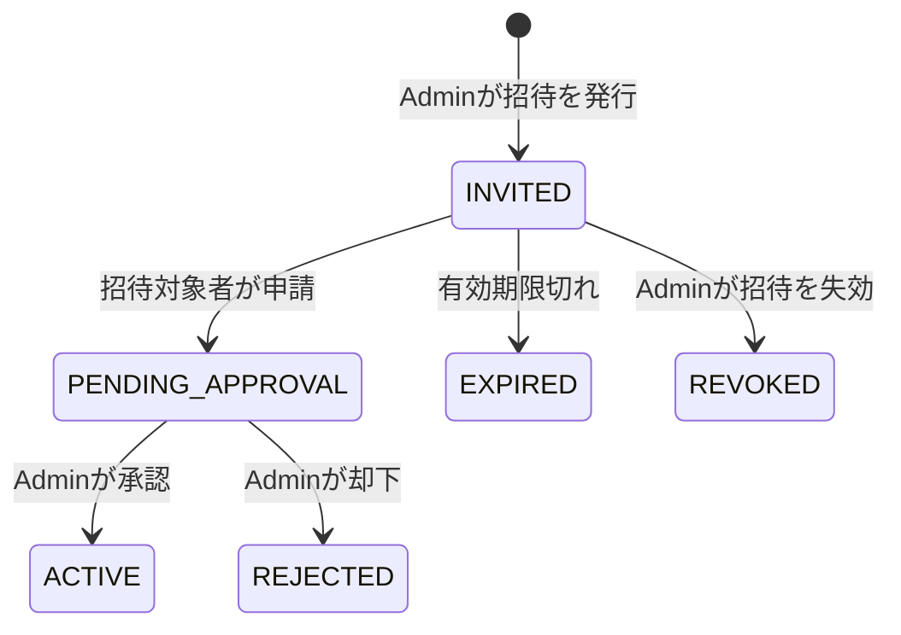

# 業務機能設計書

## 1. 文書情報

| 項目 | 内容 |
| --- | --- |
| バージョン | 1.0 |
| 状態 | 初版 |
| 対応する概要設計 | [overview-design.md](../overview-design.md) |
| 主な利用者 | プロダクト担当、フロント/バックエンド開発者、テスト担当 |

## 2. 機能一覧

| ID | 機能 | 初期リリース |
| --- | --- | --- |
| F-01 | 招待発行、申請、Admin承認/却下 | 対象 |
| F-02 | ユーザー名・パスワードによるログイン/ログアウト、アカウント名（表示名）・パスワードの変更 | 対象 |
| F-03 | トレーニング記録の作成・参照・更新・個別削除 | 対象 |
| F-04 | 標準種目カタログ（参照のみ。独自種目の作成・変更・削除は廃止） | 対象 |
| F-05 | 定型メニューの管理とメニューからの記録開始。記録は「まとめて実行」と「1種目ずつ実行」を選べる | 対象 |
| F-06 | 履歴検索、種目別推移（最大重量・トレーニング量・回数・時間・推定kcalのグラフ） | 対象 |
| F-07 | 体重・体脂肪率の測定と推移グラフ、身長の一度だけの登録 | 対象 |
| F-08 | 本人データCSVエクスポート | 対象外 |
| F-09 | アカウント削除・本人データ全件削除 | 対象外 |
| F-10 | トレーニング中の音楽再生 | MVP後。方式比較は8章。推奨は「端末の音楽ファイル再生」→必要ならSpotify（個人利用規模） |
| F-11 | 事前登録済み係数による消費カロリー推定（全標準種目） | 対象 |

初期アカウント数は一般利用者2名と開発者Admin1名の計3名を想定する。Adminは1名のみとする。

## 3. アカウント申請と承認

### 3.1 フロー

1. Adminが招待を発行する。有効期限付きの一回使用トークンを発行する。
2. 招待対象者が有効なリンクを開き、ユーザー名とパスワードを登録する。
3. サーバーはアカウントを`PENDING_APPROVAL`として作成し、招待を申請済みにする。この段階ではログインを拒否する。
4. Adminが承認待ち一覧で申請を確認し、承認または却下する。
5. 承認するとアカウントを`ACTIVE`にし、本人がログインできる。却下されたアカウントはログインできない。

### 3.2 業務ルール

- 招待がない公開登録は許可しない。
- 招待トークンは暗号学的に推測困難な乱数とし、DBにはハッシュ値を保存する。平文トークンは発行時に一度だけ表示し、ログへ出力しない。
- 招待の有効期限、失効、使用済みをサーバー側で検査し、同じ招待を二度使用できないようにする。
- ユーザー名は前後空白を除去し、大小文字の扱いを統一して一意性を検査する。
- Adminの承認前後を問わず、一般利用者が他のユーザーを承認・停止できない。
- 初期Adminは安全な初期化処理で作成し、固定パスワードをリポジトリに保存しない。
- パスワードリセット方式は未決。実装前に運用・本人確認方法を決める。

### 3.3 アカウント情報の変更

- ログイン中の利用者は、アカウント名（ヘッダー等に表示する表示名）を1〜100文字で変更できる。ログインに使うユーザー名は変更しない（セッションの識別子であり、変更時の再認証・重複検査の運用が未決のため）。
- パスワードは現在のパスワードを確認したうえで変更する。新しいパスワードは12〜128文字で、現在と同じ値は拒否する。変更後はセッションIDを更新し、監査イベント`PASSWORD_CHANGED`を記録する。
- 他の利用者のアカウント情報は変更できない（対象は常に認証済みセッションの本人）。

## 4. トレーニング記録

### 4.1 構造と入力規則

トレーニング記録は実施日、任意メモ、順序付きの種目項目からなる。種目項目は複数セットを持つ。

- 1セットに入力する運動量は回数または時間のいずれか一方。
- 重量は任意。入力する場合はkgで0以上。端数精度はDB設計に従う。
- 回数は正の整数。時間は正の秒数を内部値とする。画面上の入力単位は画面設計で定義する。
- 同日に複数のトレーニング記録を作成できる。日付と作成時刻で表示順を決める。
- 空のセット、空の種目項目を保存するかはAPI入力検証で統一する。初期案ではセットを1つ以上必須とする。
- 利用者が自身の記録を編集・個別削除できる。削除は子の種目項目とセットを含めて一貫して処理する。

### 4.1.1 記録の進め方

記録画面では次の2つの進め方を選べる。どちらも保存されるトレーニング記録の形式は同じ。

| 進め方 | 流れ | 保存の契機 |
| --- | --- | --- |
| まとめて実行（従来） | 全種目のセットを組む → 実行開始 → セットを順に実行 | 最後のセットの「完了して記録」 |
| 1種目ずつ実行 | 1種目のセットを組む → 実行 → 「この種目を完了」→ 次の種目を設定 → 実行 …… | 種目の設定画面で「完了して記録」 |

- 1種目ずつ実行では、組み立て中のセットは同じ種目に限る。実行を終えた種目は「完了した種目」として順に保持し、途中で中止しても完了済みの種目は失わない。
- 「完了して記録」で保存するのは実行を終えた種目のセットだけで、組み立て中の未実行セットは含めない。
- 作成中・完了済みのセットがある間は進め方を切り替えられない。保存済みメニューからの自動開始は「まとめて実行」で行う。

### 4.3 消費カロリー計算

- 標準種目すべてに、`exercise_calorie_rates`へ記録形式・RPE帯ごとのMET係数をseedする。器具名の項目（ダンベル、スミスマシン、パワーラック）とスクワットは一般的な筋トレとして扱う（V10）。
- RPEは1〜10で入力する。筋トレはRPE 1〜6を3.5 MET、RPE 7〜10を6.0 MET、有酸素種目はRPE 1〜4を3.5 MET、5〜7を6.0 MET、8〜10を8.0 METとする初期推定帯を使う。個別種目への割当とRPE帯は実測値ではない。
- 回数セットの動作時間は初期値を3秒/回とし、休憩は含めない。時間セットは入力された実施秒数を用いる。筋トレ種目を時間で記録したセット（保持系など）も、その種目のRPE帯と同じMETで推定する（V10）。
- 有酸素マシン（トレッドミル等）は回数では1回あたりの動作時間を決められないため、時間でのみ記録・推定する。記録画面では回数を選択できない。
- 推定できない例外は、保存済みメニューで有酸素マシンに回数を設定していた場合（上記の理由）のみ。記録の保存は止めずに未計算として表示する。独自種目は廃止したため（4.2）、推定対象外の種目は存在しない。
- 体重は身体測定で登録した最新の体重を使用し、セット登録画面では再入力しない。未登録の場合は身体測定への案内を表示し、推定対象のセット追加を止める。
- 記録詳細で回数・時間を変更したセットは、元の推定のRPE（不明な場合は6）と最新の体重で保存時に推定し直す。
- サーバーはMET式 `kcal = MET × 3.5 × 体重kg ÷ 200 × 動作分` で計算し、小数第2位へ丸める。外部重量は保存するが、初期版ではRPE選択の代用とせず、METの選択はRPEで行う。
- 推定入力、適用係数ID、推定値を`exercise_calorie_estimates`へ保存する。係数改訂後も既存推定は自動変更しない。
- 未対応種目や係数未登録の場合はカロリーを0と扱わず、未計算と表示する。
- 消費カロリーは目安であり、医学的・生理学的精度を保証しない。係数の出典とアプリ側仮定をDBに残す。

### 4.2 種目とメニュー

- 種目は全利用者共通の標準種目だけとし、参照専用で提供する。標準種目の追加・変更はFlywayマイグレーションで行う。
- 利用者が独自の種目を作成・変更・削除する仕様は廃止した（API・画面・DB列`exercises.owner_user_id`とも削除。V11）。既存の独自種目を使った記録のセットとメニューの種目はV11で削除し、独自種目だけの記録は記録ごと削除する。
- 定型メニューは名前、任意説明、種目の順序を持つ。初期仕様では目標回数・時間・重量はメニューに保持せず、実際の記録時に各セットへ入力する。
- メニューから記録を作成した時点で種目一覧を記録側へ複製する。以後メニューを変更しても既存記録を変更しない。

## 5. 履歴・集計

- 履歴は実施日の降順、同日の場合は作成日時の降順で表示する。
- 検索条件は期間と種目。利用者IDはログインユーザーに固定し、画面から変更できない。
- 最大重量は重量が入力されたセットの最大値とする。重量未入力のセットは対象外。
- トレーニング量は、回数と重量が両方あるセットの`重量kg × 回数`の合計とする。
- 時間セット、回数のみのセットはトレーニング量計算に含めない。時間の合計を表示する場合は別指標として扱う。
- 同一実施日に複数セッションがある場合、個々のセッションと日単位集計を混同しない。初期画面はセッション単位の詳細を表示する。

### 5.1 種目別推移

- 記録したことのある種目を、最終実施日の新しい順に選択肢として出す。
- 期間（1か月/3か月/1年/全期間、初期値3か月）を選び、記録（セッション）ごとに1点として次の指標を表示する。同日に複数の記録がある場合も合算しない。
  - 最大重量: 重量を入力したセットの最大値。重量のない記録は点を出さない（0として扱わない）。
  - トレーニング量: 回数と重量が両方あるセットの`重量kg × 回数`の合計。該当セットがない記録は点を出さない。
  - 合計回数: 重量を入力していない種目（自重など）で表示する。
  - 合計時間（分）: 時間で記録したセットの合計。休憩は含まない。
  - 推定消費カロリー: 推定できたセットの合計。
- 本人の記録だけを集計する。

## 6. 身体測定

- 測定項目は体重kgと体脂肪率%。身長は基本的に変わらないため測定履歴に含めず、アカウントに一度だけ登録する（`users.height_cm`、50〜300cm、小数第1位まで）。入力誤りに備えて修正は許可する。既存の身長測定はV9で最新値をアカウントへ移し、測定項目`height_cm`は無効化した。
- 測定は項目マスタを参照し、値、単位、測定日時を保存する。
- 同日複数回の測定を許可する。利用者ID、測定項目、測定日時で識別する。
- 将来追加の単純な数値項目は測定項目マスタに追加し、測定値テーブルに行を追加する。項目ごとの異なる単位・範囲・入力UIが必要な場合は機能追加としてレビューする。
- 体重・体脂肪率は本人のみ参照・編集・個別削除できる。追加の測定項目は後続対応とする。
- 体重・体脂肪率の推移は期間（1か月/3か月/1年/全期間、初期値3か月）を選んで折れ線グラフで表示する。単位が違うため1つのグラフに重ねず（二軸にしない）、項目ごとにグラフを分ける。

## 7. CSVエクスポートと削除

- 本人データCSVエクスポートは初期リリースに含めない。将来追加時は本人データへの限定、文字コード、値形式、CSV Injection対策を別途設計する。
- 個別の記録・測定の削除は提供する。
- アカウント削除および利用者の全データ一括削除は、初期リリースでは画面・APIとも提供しない。法令・サービス運用上の削除要求に備えた運用手順は公開前に別途決める。

## 8. トレーニング中の音楽再生（MVP後・方式比較）

2026/10/17時点の比較。外部サービスの規約・制限は変わるため、実装直前に公式情報を再確認する。

| 方式 | 費用・前提 | 主な課題 | 評価 |
| --- | --- | --- | --- |
| Spotify（Web Playback SDK＋Web API） | 利用者全員がPremium（Lite/Miniなどモバイル専用プランは不可）。開発者もPremium | 開発モードは1アプリ5名まで（許可リスト登録制）。一般公開に必要な拡張枠は「登録法人・月間アクティブ25万人以上」の組織のみ申請可。OAuth（PKCE）とトークン更新、iOSでは利用者操作なしで再生が始まらない | 3名運用なら利用可。公開・拡大はほぼ不可 |
| YouTube（IFrame Player API） | 無料（広告あり。Premium会員なら広告なし） | 再生プレーヤーを200×200px以上で表示する必要があり、音声だけの再生・プレーヤーを隠す使い方は規約上できない。画面ロック・別アプリ表示中は止まる。広告で中断。自動再生制限 | 「動画を見ながら」なら可。音楽プレーヤー用途には不向き |
| 端末の音楽ファイル（利用者が選ぶ） | 無料。サーバー保存なし | ファイル選択はページを開くたびに必要（ブラウザーの制約）。iOS Safariは画面ロックで止まることがある。ストリーミング曲（Spotify等の楽曲）は使えない | 最も簡単で規約リスクなし |
| フリー音源をアプリで配信 | 素材は無料〜。保存・配信の容量 | 曲ごとの利用条件（クレジット表記・再配布可否・商用可否）の確認と記録、著作権表示、配信容量、曲数が限られる | 小規模なら可。権利管理の手間 |
| Apple Music（MusicKit JS） | 開発者登録 年99米ドル、利用者はApple Music会員 | Spotifyと同様のOAuth・会員前提、ブラウザー差 | 利用者がApple Music派なら候補 |

**推奨案**: まず「端末の音楽ファイル再生」を実装する（外部登録・規約・課金なし、記録画面にプレーヤーを置ける）。Spotify連携は、利用者が3名・Premium会員である現状なら開発モードで成立するが、5名の上限があり公開できないため、個人利用の付加機能として後から判断する。YouTubeは映像表示が必須なため、音楽プレーヤーとしては採用しない。

**共通の実装課題**:
- 記録画面のタイマー終了音（ビープ）と音楽の音量の兼ね合い（終了音の前に音量を下げる等）。
- スマートフォンの画面ロック・別アプリ切替時の継続再生（ブラウザーでは保証できない。PWA化しても制約あり）。
- 自動再生の制限: 最初の再生は必ず利用者のタップから開始する。
- 記録画面の状態（メニュー作成⇔実行）を切り替えても再生を止めないよう、プレーヤーを画面全体の共通部品に置く。

## 9. 機能受け入れ条件

- 招待済み利用者は申請後、Admin承認前にはログインできない。承認後にログインできる。
- 一般利用者は他利用者の記録・測定・メニューを参照・変更できない。
- 1セットで回数か時間のどちらか一方と任意重量を記録でき、同日に複数のトレーニングを保存できる。
- メニューから記録を開始し、メニュー変更が既存記録へ反映されない。
- 体重・体脂肪率を複数回/日記録でき、時系列で確認できる。身長はアカウントに一度だけ登録でき、測定として登録できない。測定項目はマスタ追加で拡張できる。
- 記録は「まとめて実行」と「1種目ずつ実行」のどちらでも保存できる。
- アカウント名とパスワードを本人が変更でき、パスワード変更には現在のパスワードが必要。
- 全標準種目で、回数・時間（有酸素マシンは時間のみ）からセット別消費カロリーとセッション合計を計算し、適用係数と推定値を保存できる。
- 推定できない場合（メニューで有酸素マシンに回数を設定した場合）でもトレーニング記録を保存でき、消費カロリーは未計算として表示される。
- 利用者は種目を作成・変更・削除できない（APIは`405`）。
- 種目別推移と体重・体脂肪率の推移を、期間を選んでグラフと数値一覧で確認できる。
- F-08のCSVエクスポートは画面/APIとも初期リリースに含まれない。
- 個別記録の削除は可能だが、アカウント・全データ一括削除APIは存在しない。
